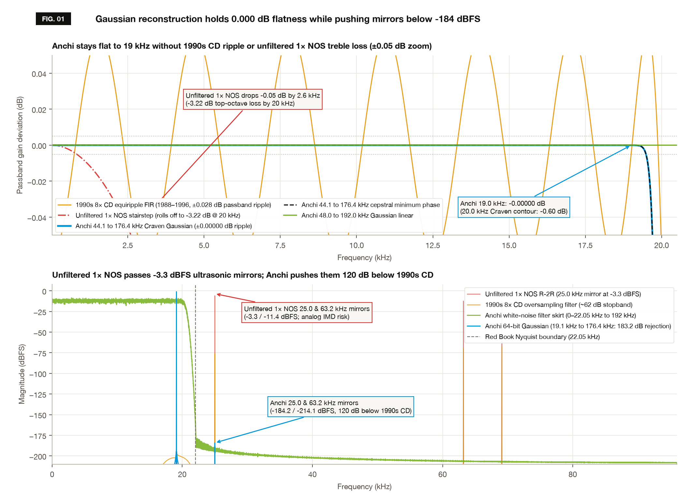
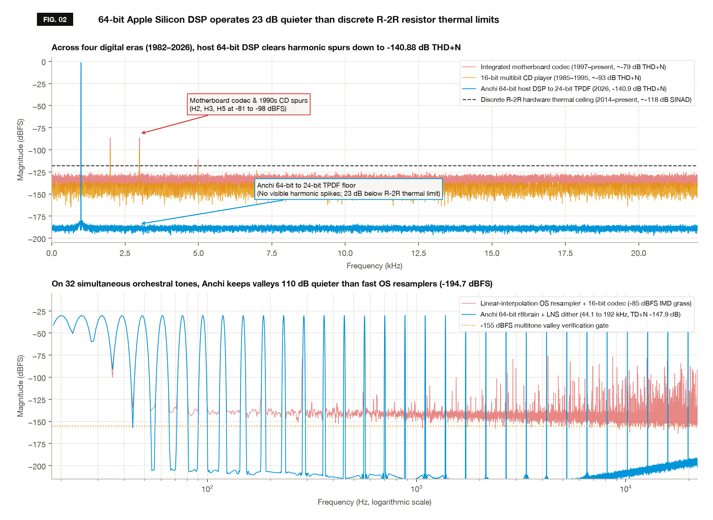
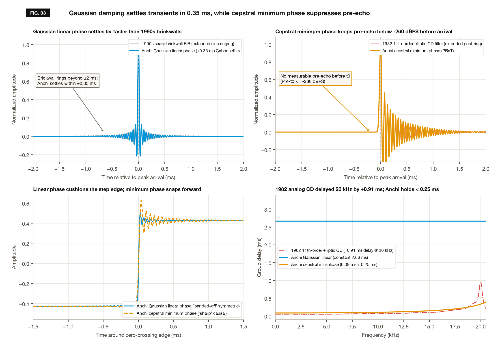
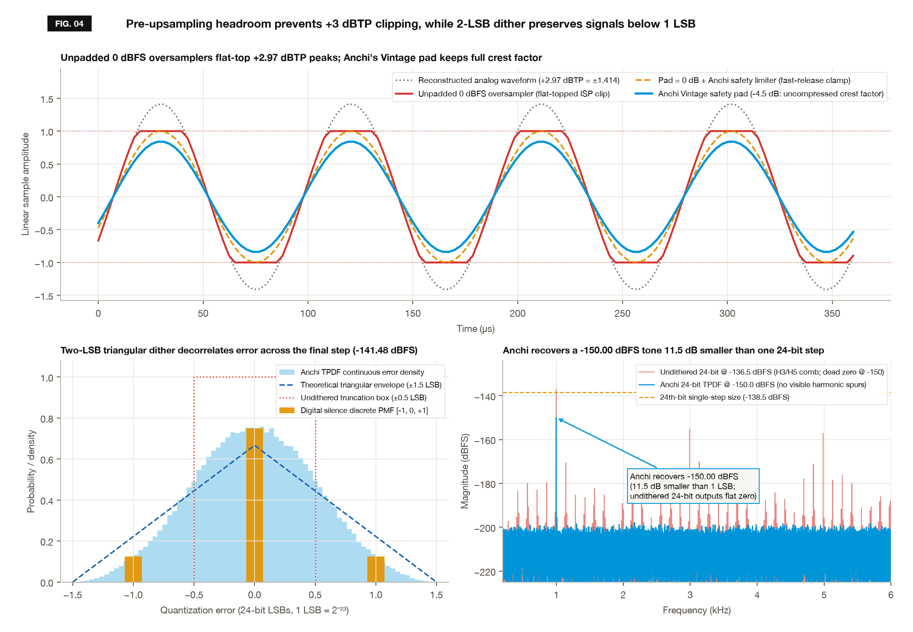

# Anchi DAC verification suite

This repository packages the 26-point automated audio verification suite behind Section 7 ("The receipts") of the Anchi DAC technical paper (*The Anchi DAC's sonic characteristics, architecture, and intentional trade-offs* by Charles Warren, Anchizuzu Audio).

It contains the open Python spectral, phase, linearity, inter-sample peak, and dither analyzers (`scripts/`), the C-ABI benchmark header (`Sources/NaitDSPBench/include/NaitDSPBench.h`), the reference measurement report and figures (`reports/loopback/`), and a prebuilt, signed `arm64` macOS dynamic library (`lib/libNaitDSPBench.dylib`) compiled from the same 64-bit DSP engine that runs inside the Anchi DAC menu bar application.

Outside engineers and listeners can inspect the FFT, THD+N, group-delay, and TPDF math directly in Python, reproduce all 26 checks on an Apple Silicon Mac in one command, or pass `--dylib` to run the same 26-gate suite against another resampling or DSP library.

---

## Quick start

Requirements: macOS 13.0 or newer on Apple Silicon (`arm64`) and Python 3.10 or newer.

```bash
git clone https://github.com/chwsfo/anchi-dac-bench.git
cd anchi-dac-bench
make test
```

On first run, `make test` creates a local `.venv` virtual environment (if `numpy`, `scipy`, and `matplotlib` are not already installed), loads `lib/libNaitDSPBench.dylib` via `ctypes`, runs all 26 checks, regenerates `FIG. 01` through `FIG. 04` in `reports/loopback/plots/`, writes `reports/loopback/summary_report.json`, and exits `0` only if `26/26` thresholds pass.

Additional targets:

- `make plots`: regenerates the four figures in `reports/loopback/plots/` and updates `reports/loopback/summary_report.json`.
- `make audition`: synthesizes level-capped (`<= -6.11 dBFS`) `.wav` listening clips in `reports/loopback/audition_clips/` (gitignored).
- `make interactive DAY=3`: opens the interactive 4-step briefing, plot inspection, and blind ABX listening exercise on the local Mac CoreAudio output (`DAY=1..4`, defaulting to `--audition-target local`).
- `make clean`: removes generated audition `.wav` clips and temporary caches.

---

## What these 26 tests measure

The suite evaluates digital audio reconstruction and quantization across five domains aligned with published measurement procedures (**AES17-2020**, **ITU-R BS.1770-4**, **CCIF** twin-tone intermodulation, and **IEEE-2000** dither moment invariance), using `262,144`-point 7-term Blackman-Harris FFTs (`>180 dB` sidelobe suppression) in 64-bit IEEE-754 floating point:

1. **Real-time ring-buffer stability (`run_preflight_checks`, rows 1 to 2):** streams `Float32` callback blocks (`512` frames and `64` frames) through the single-producer, single-consumer (`SPSC`) ring buffer and production output renderer at `44.1 kHz -> 176.4 kHz` with the `-6.0 dBFS` Vintage safety ceiling engaged, checking for zero buffer underruns and bounded peak output.
2. **Frequency response and ultrasonic stopband (`run_day1`, rows 3 to 9):** measures `Float64` passthrough null residual on a 10-second Farina logarithmic chirp (`10 Hz` to `0.49 fs`), passband flatness (`20 Hz` to `19 kHz` at `44.1 kHz`; `20 Hz` to `20 kHz` at `48 kHz` and `192 kHz`), oscillatory passband ripple, Peter Craven's `-0.60 dB @ 20 kHz` Gaussian-apodizing contour (`>140 dB` null by `22.00 kHz`), synchronous (`44.1 -> 176.4 kHz`) and asynchronous rational (`44.1 -> 96 / 192 kHz` via `r8brain-free-src`) ultrasonic image rejection on a `-1 dBFS` `19.1 kHz` tone, CCIF `19 + 20 kHz` twin-tone difference-frequency distortion, and stereo `L/R` gain balance.
3. **Harmonic linearity and multitone density (`run_day2`, rows 10 to 14):** measures notched AES17 `20 Hz to 20 kHz` THD+N and spurious-free dynamic range (`SFDR`) for `16-bit -> 24-bit` Red Book playback, a 10-pair sample-rate matrix quantized to `24-bit TPDF` (plus a `41 Hz` biquad pole-precision stress test at `192 kHz` and a `6,997 Hz` high-slew tone), `Float32` CoreAudio transport, `-60 dBFS` low-level gain linearity, and a Newman-phased 32-tone orchestral multitone stimulus (`44.1 -> 192 kHz` with 2nd-order ultrasonic noise-shaped `LNS` dither).
4. **Impulse settling, phase, group delay, and live switching (`run_day3`, rows 15 to 20):** excites both reconstruction topologies (`Gaussian smooth` linear phase and cepstral `Minimum phase`) with a 64-bit Dirac impulse (`48 -> 192 kHz`), checking Type-II tap symmetry, pre-arrival causal silence (`t < t0`), post-impulse decay below `-120 dB`, phase deviation against a flat linear reference and an analytical real-cepstrum Hilbert target, group-delay ripple and top-octave rise, inter-channel `L/R` phase match, and click-free `500 ms` raised-cosine `VCA` filter/bypass transitions on a live `440 Hz` tone (`>5 kHz` high-pass RMS and second-difference `Δ²x[n]` continuity).
5. **Inter-sample peak headroom and sub-LSB `TPDF` dither (`run_day4`, rows 21 to 26):** drives `8x` (`352.8 kHz`) oversampling with ITU-R BS.1770-4 inter-sample peak (`ISP`) torture vectors (`+2.97 dBTP` `fs/4` phase-shifted cosine and `+5.11 dBTP` phase-reversed sinc bursts) plus a `200 ms` `+3 dBFS` overload step to test pre-upsampling voltage pads and limiter release recovery (`<50 ms`, zero integer wraps). Then evaluates `24-bit` `2-LSB` triangular (`TPDF`) dithering on `10.0 s` of digital silence (`[-1, 0, +1] LSB` discrete probability mass function `[0.125, 0.750, 0.125]`), Welch power spectral density whiteness (`20 Hz` to `fs/2`), `32x` coherently averaged recovery of a `-150.0 dBFS` sine (`11.5 dB` below one 24-bit step), and high-band (`2 to 20 kHz`) noise-floor invariance during a `40 Hz` bass conditioning sweep.

---

## One-to-one map to the 26 white paper receipts

Every row in [`reports/loopback/summary_report.json`](reports/loopback/summary_report.json) corresponds in exact order (`1` through `26`) to the verification table in Section 7 ("The receipts") of the Anchi DAC white paper:

| # | `metric_id` in `summary_report.json` | Analyzer in `scripts/loopback_lab/` | Domain & metric | Standard / condition | Reference measurement | Pass criterion |
| :---: | :--- | :--- | :--- | :--- | :--- | :--- |
| 1 | `preflight_rt_512f` | `days.py::run_preflight_checks` | **Real-time:** SPSC callback (`512f`) | `44.1k -> 176.4k`, Vintage `-6 dBFS` lock | `0 underruns, peak -12.02 dBFS` | `0 underruns & <= -5.99 dBFS` |
| 2 | `preflight_rt_64f` | `days.py::run_preflight_checks` | **Real-time:** SPSC callback (`64f`) | `44.1k -> 176.4k`, tight I/O quantum | `0 underruns, peak -12.02 dBFS` | `0 underruns & <= -5.99 dBFS` |
| 3 | `day1_passthrough_null` | `days.py::run_day1` | **Frequency:** Passthrough null error | `10 Hz to 0.49 fs` Farina log chirp | `-300.0 dBFS (±0.0000 dB)` | `Residual < -180.0 dBFS` |
| 4 | `day1_passband_flatness` | `days.py::run_day1` | **Frequency:** Passband flatness | AES17 `20 Hz to 19k` (`44.1k`) & `20k` (`48k`) | `±0.00000 dB` | `<= ±0.0050 dB` |
| 5 | `day1_passband_ripple` | `days.py::run_day1` | **Frequency:** Passband ripple | Gaussian-apodizing linear phase | `±0.000000 dB` | `< ±0.0010 dB` |
| 6 | `day1_gaussian_rolloff_20k` | `days.py::run_day1` | **Frequency:** Craven contour @ `20 kHz` | `44.1k -> 176.4k` (`22.00 kHz` null) | `-0.601 dB (-144.8 dB @ 22k)` | `-0.60 ± 0.15 dB` |
| 7 | `day1_stopband_sync` | `days.py::run_day1` | **Stopband:** Sync image rejection | AES17 `19.1 kHz @ -1 dBFS` (`44.1k -> 176.4k`) | `183.2 dB (-184.2 dBFS)` | `>= 130.0 dB` |
| 8 | `day1_stopband_async` | `days.py::run_day1` | **Stopband:** Async image rejection | `19.1 kHz @ -1 dBFS` (`44.1k -> 96k/192k`) | `183.4 dB (-184.4 dBFS)` | `>= 125.0 dB` |
| 9 | `day1_channel_balance` | `days.py::run_day1` | **Frequency:** Channel balance (`L/R`) | `20 Hz to 20 kHz` stepped sines | `±0.000000 dB` | `<= ±0.0001 dB` |
| 10 | `day2_16_to_24_thdn` | `days.py::run_day2` | **Linearity:** `16-bit -> 24-bit` THD+N | AES17 `997 Hz @ -1 dBFS` (`44.1k -> 176.4k`) | `-94.51 dB (SFDR 129.9 dB)` | `<= -93.0 dB & SFDR >= 110 dB` |
| 11 | `day2_24_tpdf_thdn` | `days.py::run_day2` | **Linearity:** `24-bit TPDF` rate matrix | AES17 10 rate pairs + `41 Hz` + `6,997 Hz` | `-140.88 dB (SFDR 178.3 dB)` | `<= -140.0 dB & SFDR >= 155 dB` |
| 12 | `day2_32f_to_32f_thdn` | `days.py::run_day2` | **Linearity:** `Float32` transport | `997 Hz @ -1 dBFS` (`44.1k -> 176.4k`) | `-152.05 dB (SFDR 179.6 dB)` | `<= -148.0 dB & SFDR >= 160 dB` |
| 13 | `day2_low_level_linearity` | `days.py::run_day2` | **Linearity:** `-60 dBFS` low-level gain | AES17 `997 Hz @ -60 dBFS` (`24-bit TPDF`) | `Err +0.0000 dB, spurs -183.5 dBFS` | `<= ±0.02 dB & <= -165 dBFS` |
| 14 | `day2_multitone_32` | `days.py::run_day2` | **Linearity:** 32-tone multitone | `20 Hz to 20 kHz` (`44.1k -> 192k`, `LNS`) | `TD+N -147.95 dB, grass -194.7 dBFS` | `<= -136.0 dB & <= -155 dBFS` |
| 15 | `day3_pre_ringing` | `days.py::run_day3` | **Time/phase:** Impulse pre-ringing | `48k -> 192k` linear vs. cepstral PRaT | `±0.000000% sym / -260.0 dBFS` | `<= ±0.01% & <= -145 dBFS` |
| 16 | `day3_post_ringing_decay` | `days.py::run_day3` | **Time/phase:** Post-ringing decay | Settling time below `-120 dB` | `3.36 ms (PRaT) / -400.0 dB (Lin)` | `< 3.50 ms & <= -120 dB` |
| 17 | `day3_phase_deviation` | `days.py::run_day3` | **Time/phase:** Phase accuracy | `20 Hz to 18 kHz` vs. Hilbert target | `±0.00000° (Lin) / ±0.0004° (PRaT)` | `<= ±0.05° & <= ±0.50°` |
| 18 | `day3_group_delay` | `days.py::run_day3` | **Time/phase:** Group delay | Passband ripple & `20 kHz` rise | `±0.00000 ms / +0.249 ms` | `<= ±0.005 ms & < 0.80 ms` |
| 19 | `day3_interchannel_phase` | `days.py::run_day3` | **Time/phase:** Inter-channel phase | `20 Hz to 20 kHz` `L` vs. `R` | `±0.000000°` | `<= ±0.001°` |
| 20 | `day3_live_vca_crossfade` | `days.py::run_day3` | **Time/phase:** Live VCA filter switch | `440 Hz @ -6 dBFS` `500 ms` crossfade | `Click -136.3 dBFS, Δ² = 0.000000` | `<= -100 dBFS & Δ² == 0` |
| 21 | `day4_vintage_safety_pad` | `days.py::run_day4` | **Headroom:** Vintage safety pad | ITU-R `+2.97 dBTP` ISP @ `-3.5/-6 dB` | `Err +0.0000 dB, 0 lim hits` | `±0.005 dB & 0% compression` |
| 22 | `day4_hard_safety_limiter` | `days.py::run_day4` | **Headroom:** Hard safety limiter | `+3.01 & +5.8 dBTP` (`Pad = 0 dB`) | `0 clips, 0 wraps, 21.5 ms recovery` | `0 clips & < 50 ms recovery` |
| 23 | `day4_tpdf_histogram` | `days.py::run_day4` | **Dither:** `24-bit TPDF` PMF & floor | AES17 `10.0s` digital silence | `-141.48 dBFS, [0.125,0.750,0.125]` | `-141.5 ± 0.3 dBFS` |
| 24 | `day4_tpdf_whiteness` | `days.py::run_day4` | **Dither:** TPDF spectral whiteness | `20 Hz to fs/2` PSD flatness | `±0.134 dB` | `<= ±0.25 dB` |
| 25 | `day4_sub_lsb_resolution` | `days.py::run_day4` | **Dither:** Sub-LSB sine recovery | `997 Hz @ -150.0 dBFS` (`11.5 dB < 1 LSB`) | `-150.00 dBFS (H3 -214.8 dBFS)` | `-150.0 ± 0.30 dBFS` |
| 26 | `day4_noise_modulation` | `days.py::run_day4` | **Dither:** Noise modulation | `40 Hz` sweep (`2 to 20 kHz` noise RMS) | `0.0216 dB shift` | `< 0.05 dB` |

Core spectral, THD+N, multitone, and phase-extraction equations live in [`scripts/loopback_lab/dsp_math.py`](scripts/loopback_lab/dsp_math.py).

---

## Reference plots

Running `make test` or `make plots` generates these four figures directly from live `libNaitDSPBench.dylib` test vectors:

### Figure 01: Passband flatness and ultrasonic stopband rejection


### Figure 02: 64-bit linearity and 32-tone multitone density


### Figure 03: Impulse settling, cepstral minimum phase, and group delay


### Figure 04: Inter-sample peak headroom and 24-bit TPDF dither


---

## Benchmarking another DSP library via `NaitDSPBench.h`

The Python harness talks to the engine under test through the C-ABI defined in [`Sources/NaitDSPBench/include/NaitDSPBench.h`](Sources/NaitDSPBench/include/NaitDSPBench.h):

- `bench_passthrough_f64`: stereo `Float64` passthrough reference.
- `bench_process_core_f64`: offline stereo `Float64` resampling, optional biquad/triode stage, headroom limiter, and `24-bit TPDF` / `LNS` / `Float32` quantizer.
- `bench_stream_realtime_dsp`: chunked `Float32` callback harness (`512` and `64` frames) with live mid-stream filter and bypass transitions.

To evaluate another C, C++, or Rust resampler (for example `libsoxr` or `libsamplerate`) against the same 26 gates, compile a shared library implementing those functions and pass `DYLIB`:

```bash
clang++ -std=c++17 -O3 -dynamiclib my_resampler_bridge.cpp \
  -ISources/NaitDSPBench/include -o build/libMyBench.dylib
make test DYLIB=build/libMyBench.dylib
```

---

## Scope, limitations, and licensing

- **In-memory DSP verification, not analog hardware metrology:** These 26 checks drive the compiled DSP engine directly in 64-bit and 32-bit memory buffers rather than routing audio through macOS CoreAudio virtual cables (`Float32`, `~-150 dBFS` transport floor) or an external analog audio analyzer. Downstream playback remains bounded by the thermal resistor noise, clock jitter, and output stage of your physical DAC and amplifier.
- **Platform:** The prebuilt `lib/libNaitDSPBench.dylib` binary targets `arm64` Apple Silicon (`macOS 13.0+`) and links only system `Accelerate.framework`, `libc++`, and `libSystem`.
- **License:** All Python verification scripts (`scripts/`), the C-ABI specification (`Sources/NaitDSPBench/include/NaitDSPBench.h`), `Makefile`, and documentation are licensed under the [MIT License](LICENSE). The prebuilt `lib/libNaitDSPBench.dylib` binary is provided free of charge for verification and benchmarking; see [`THIRD_PARTY_NOTICES.md`](THIRD_PARTY_NOTICES.md) for scope details and open-source attributions (`r8brain-free-src` by Aleksey Vaneev, `PFFFT` by Julien Pommier, Hayati Ayguen, Dario Mambro, and NCAR/UCAR, `EBU Tech 3253 SQAM`, and Kimiko Ishizaka's *Open Goldberg Variations*).
